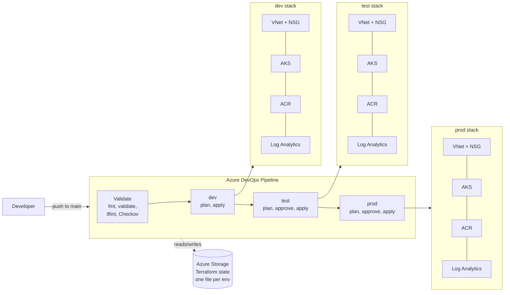

# AKS Platform on Azure: Terraform + Azure DevOps

Infrastructure as Code for a multi-environment **Azure Kubernetes Service (AKS)** platform, deployed through a **multi-stage Azure DevOps pipeline** with plan review, manual approval gates, and automated security scanning.


---

## TL;DR

Push to `main` and the pipeline will:

1. **Validate** the code (format, syntax, lint, security scan).
2. **Deploy `dev`** automatically.
3. **Pause for human approval**, then deploy `test`.
4. **Pause for human approval again**, then deploy `prod`.

Every environment gets its own network, container registry, Kubernetes cluster and logging workspace, all defined in code and built from the same modules. Only the sizing differs.

---

## What this project demonstrates

| Skill | Where to see it |
|---|---|
| Infrastructure as Code (Terraform) | `infra/` with reusable modules |
| Multi-environment management | `infra/env/*.tfvars` with isolated state per environment |
| CI/CD pipeline design | `pipelines/` with a reusable stage template |
| Safe deployment practices | Plan once, approve, then apply that exact plan |
| Cloud security basics | No stored secrets, Azure AD auth, least-privilege image pulls |
| Kubernetes on Azure | AKS with autoscaling, workload identity, network policy |
| Observability | Log Analytics and Container Insights |
| DevSecOps | `terraform fmt`, `validate`, `tflint` and `Checkov` in CI |

---

## Architecture



### Resources created per environment

| Resource | Details |
|---|---|
| Resource group | Holds everything for the environment |
| Virtual network | Dedicated address space per environment (no overlap) |
| Subnet + NSG | `snet-aks` with a network security group attached |
| Azure Container Registry | Admin user **disabled**; AKS pulls using the `AcrPull` role |
| AKS cluster | Autoscaling node pool, Azure CNI, Azure network policy, OIDC issuer and workload identity, automatic patch upgrades |
| Log Analytics workspace | Container Insights enabled on the cluster |
| Role assignment | Grants the cluster's kubelet identity `AcrPull` on the registry |

---

## Environment sizing

The same code is deployed three times. Only the `.tfvars` inputs change.

| Setting | dev | test | prod |
|---|---|---|---|
| VNet address space | `10.10.0.0/16` | `10.20.0.0/16` | `10.30.0.0/16` |
| AKS subnet | `10.10.1.0/24` | `10.20.1.0/24` | `10.30.1.0/24` |
| Node VM size | `Standard_D2s_v5` | `Standard_D2s_v5` | `Standard_D4s_v5` |
| Autoscaler (min to max nodes) | 1 to 2 | 1 to 3 | 2 to 5 |
| ACR SKU | Basic | Standard | Premium |
| Log retention | 30 days | 30 days | 90 days |
| Approval required before apply | No | Yes | Yes |

---

## Repository layout

```
.
├── infra/
│   ├── main.tf              # Wires the modules together
│   ├── variables.tf         # Input variables (with validation)
│   ├── outputs.tf           # Useful outputs (cluster name, ACR login server, kubectl command)
│   ├── versions.tf          # Terraform + provider versions, remote backend
│   ├── env/
│   │   ├── dev.tfvars
│   │   ├── test.tfvars
│   │   └── prod.tfvars
│   └── modules/
│       ├── network/         # VNet, subnet, NSG
│       ├── acr/             # Container registry
│       └── aks/             # AKS cluster, Log Analytics, AcrPull role assignment
├── pipelines/
│   ├── azure-pipelines.yml          # Validate → dev → test → prod
│   └── templates/
│       └── terraform-env.yml        # Reusable stage: plan → approve → apply
└── scripts/
    └── bootstrap-state.sh           # One-time creation of remote state storage
```

---

## How the pipeline works

```
Validate ──► dev ──► test ──► prod
              │        │        │
              │        └─ approval gate (Azure DevOps Environment)
              └─ plan, apply
```

**Validate stage** (runs on every push and pull request):

- `terraform fmt -check`: enforces consistent formatting
- `terraform validate`: catches syntax and configuration errors
- `tflint`: lints for common mistakes
- `Checkov`: scans for security misconfigurations (currently *soft-fail*; see [Limitations](#known-limitations-and-roadmap))

**Each environment stage** is generated from one reusable template:

1. **Plan job:** `terraform init` and `terraform plan -out=tfplan`. The plan is published as a pipeline artifact, along with a human-readable `.txt` version for reviewers.
2. **Apply job:** bound to an Azure DevOps **Environment**. If that Environment has an *Approvals* check, the run pauses until someone approves. The job then downloads the saved plan and runs `terraform apply` on **exactly that plan**.

Pull requests run **Validate only**. Deployments happen only from `main`.

---

## Design decisions

- **Plan once, apply that plan.** The reviewed plan is the one that gets applied, so there are no surprises between review and deployment.
- **No secrets in the repo.** The pipeline authenticates through an Azure DevOps service connection (workload identity federation recommended). State access uses Azure AD, not storage keys.
- **Remote state with protection.** The state storage account is private, TLS 1.2 only, with blob versioning and 14-day soft delete. Each environment has its own state file, so they can't affect each other.
- **One module per concern.** Network, registry and cluster are separate modules and can be reused or swapped independently.
- **Per-environment sizing via tfvars.** No code duplication across environments.
- **Non-overlapping address spaces.** The environments can be peered later without re-addressing.
- **No registry passwords.** ACR admin is disabled, and the cluster pulls images through an `AcrPull` role assignment.
- **Security scanning in CI.** Findings are visible on every run without blocking early development.

---

## Prerequisites

- An Azure subscription and the [Azure CLI](https://learn.microsoft.com/cli/azure/install-azure-cli) (`az login`)
- [Terraform](https://developer.hashicorp.com/terraform/install) `>= 1.6`
- An Azure DevOps organization and project

---

## Getting started

### 1. Bootstrap remote state (once per subscription)

```bash
./scripts/bootstrap-state.sh westus2
```

This creates a resource group, a storage account and a `tfstate` container. Note the three values it prints.

### 2. Configure Azure DevOps

1. **Service connection:** create an *Azure Resource Manager* connection named `sc-azure-aks-platform` (workload identity federation recommended). Grant its identity:
   - `Contributor` on the subscription
   - `User Access Administrator` on the subscription (needed for the `AcrPull` role assignment)
   - `Storage Blob Data Contributor` on the state storage account
2. **Environments:** create `aks-dev`, `aks-test` and `aks-prod`. Add an **Approvals** check to `aks-test` and `aks-prod`.
3. **Variables:** add `tfstateResourceGroup`, `tfstateStorageAccount` and `tfstateContainer` (as pipeline variables or in a variable group).
4. **Pipeline:** create a new pipeline pointing at `pipelines/azure-pipelines.yml`.

### 3. Run

Push to `main`. The pipeline validates, plans and applies `dev`, then waits for your approval before `test` and `prod`.

---

## Running locally (optional)

```bash
cd infra
export ARM_SUBSCRIPTION_ID=$(az account show --query id -o tsv)
export ARM_USE_AZUREAD=true

terraform init \
  -backend-config="resource_group_name=rg-tfstate" \
  -backend-config="storage_account_name=<your-storage-account>" \
  -backend-config="container_name=tfstate" \
  -backend-config="key=aks-platform-dev.tfstate"

terraform plan -var-file=env/dev.tfvars
```

Then connect to the cluster using the `get_credentials_command` output:

```bash
terraform output get_credentials_command
```

---

## Cost notes

`dev` is a small fraction of the cost of `prod`: one or two `Standard_D2s_v5` nodes, a Basic registry and a small Log Analytics workspace. Prices vary by region, so check the [Azure pricing calculator](https://azure.microsoft.com/pricing/calculator/).

> **Destroy environments you are not using.** AKS nodes bill while they run.

---

## Cleanup

```bash
cd infra
terraform destroy -var-file=env/dev.tfvars
```

Then delete the `rg-tfstate` resource group if you no longer need remote state.

---

## Known limitations and roadmap

This is a solid foundation, intentionally kept simple. Things I would harden for a real production workload:

- [ ] **Private AKS cluster** (the API server is currently public) with a jump host or private endpoints
- [ ] **Azure AD integration** and disabling local accounts
- [ ] **NSG rules:** the NSG is attached but has no custom rules yet
- [ ] **Separate subscriptions and service connections** per environment (currently one shared connection)
- [ ] **Enforce Checkov** (switch from soft-fail to blocking once findings are triaged)
- [ ] **Separate system and user node pools**, plus a spot pool for cheap workloads
- [ ] **Azure Key Vault** with the CSI secrets driver
- [ ] **Azure Policy** and Defender for Containers
- [ ] **Terraform tests** (`terraform test`) and **Infracost** in the pipeline

---

## Author

**Rajeswar Reddy Pondugula**
[LinkedIn](www.linkedin.com/in/rajeswarreddy-pondugula) · [GitHub](https://github.com/Rajeswarrddy)

---
